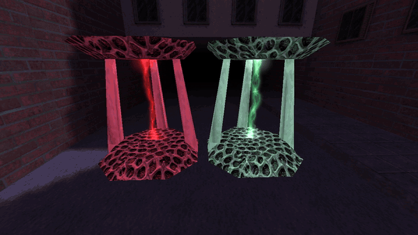

<h1 align="center">Teleporter</h1>

<p align="center">
  
</p>

## 📝 Description
This plugin adds a fully dynamic Teleporter system to Counter-Strike 1.6.
Teleporters can be placed, managed and configured during gameplay with runtime control over visibility, team access, activation states and exit destinations.

## 💬 Commands
- `say /teleporter` - Opens the Teleporter menu.
- `say_team /teleporter` - Opens the Teleporter menu.
- `teleporter_reload` - Reloads the configuration file.

## ⚙️ Configuration
```ini
# Per-teleporter settings (defined under each [Teleporter Name] section):
# TELEPORTER_FLAGS              = a - Dynamic Light    b - Sound               c - Cooldown               d - Random Destination      e - Players Only
# TELEPORTER_TEAM               = 0 - None             1 - Terrorist           2 - Counter-Terrorist      3 - Both
# TELEPORTER_SPRITE_EXIT        = Exit arrival sprite path
# TELEPORTER_SPRITE_GLOW        = Glow sprite path for the teleporter base/top
# TELEPORTER_GLOW_SCALE         = Glow sprite scale (1.0 = normal size)
# TELEPORTER_GLOW_COLOR         = Glow sprite color (RGB values 0 - 255)
# TELEPORTER_GLOW_ALPHA         = Glow sprite transparency (0 - 255)
# TELEPORTER_BEAM               = Beam sprite path
# TELEPORTER_BEAM_WIDTH         = Main beam width
# TELEPORTER_BEAM_NOISE         = Main beam noise/distortion
# TELEPORTER_BEAM_COLOR         = Main beam color (RGB values 0 - 255)
# TELEPORTER_BEAM_ALPHA         = Main beam transparency (0 - 255)
# TELEPORTER_BEAM_LIFE          = Main beam life in 0.1s
# TELEPORTER_SPRITE_FRAMERATE   = Exit sprite animation speed (FPS)
# TELEPORTER_SPRITE_SCALE       = Exit sprite scale (1.0 = normal size)
# TELEPORTER_SPRITE_COLOR       = Exit sprite color (RGB values 0 - 255)
# TELEPORTER_SPRITE_ALPHA       = Exit sprite transparency (0 - 255)
# TELEPORTER_DLIGHT_RADIUS      = Enter dynamic light radius
# TELEPORTER_DLIGHT_COLOR       = Enter dynamic light color (RGB values 0 - 255)
# TELEPORTER_DLIGHT_LIFE        = Enter dynamic light life in 0.1s
# TELEPORTER_EXIT_BEAM_COUNT    = Exit burst beam count (min max)
# TELEPORTER_EXIT_BEAM_LENGTH   = Exit burst beam length range (min max)
# TELEPORTER_EXIT_BEAM_WIDTH    = Exit burst beam width range (min max)
# TELEPORTER_EXIT_BEAM_NOISE    = Exit burst beam noise range (min max)
# TELEPORTER_EXIT_BEAM_COLOR    = Exit burst beam color (RGB values 0 - 255)
# TELEPORTER_EXIT_BEAM_ALPHA    = Exit burst beam transparency (0 - 255)
# TELEPORTER_EXIT_BEAM_LIFE     = Exit burst beam life range in 0.1s (min max)
# TELEPORTER_EXIT_DLIGHT_RADIUS = Exit dynamic light radius range (min max)
# TELEPORTER_EXIT_DLIGHT_COLOR  = Exit dynamic light color (RGB values 0 - 255)
# TELEPORTER_EXIT_DLIGHT_LIFE   = Exit dynamic light life range in 0.1s (min max)
# TELEPORTER_COOLDOWN           = Cooldown range in seconds before the teleporter can be used again (min max)
```

## 🔄 Changelog
```text
* v1.0: Initial release.
```

[](https://www.youtube.com/watch?v=qvdJO_i9360)
